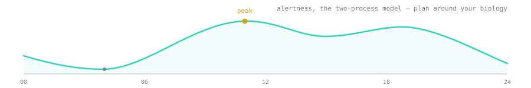

  

# Azra Bano

ECE at Rutgers. Previously SWE at Google. Founded [AeroBin](https://github.com/azrabano23/aerobin-routing) (smart waste sensors, 1st place national Verizon Smart Campus). Quantum ML for leukemia detection with Columbia ([arXiv:2601.18710](https://arxiv.org/abs/2601.18710)).

I like problems where the number has to be right: GPU performance, model internals, firmware for prosthetics and brain stimulation, exchange latency in hardware, and clinical tools.

逆水行舟，不進則退

## Things worth looking at

**ML systems**
- [llm-roofline](https://github.com/azrabano23/llm-roofline) predicts LLM inference speed and cost on NVIDIA GPUs from the spec sheet. No GPU needed.
- [disagg-sim](https://github.com/azrabano23/disagg-sim) simulates prefill/decode disaggregation and KV-cache routing (DistServe, Mooncake, Dynamo) in 1.7k lines of numpy.
- [lowbit](https://github.com/azrabano23/lowbit) 4-bit weight GEMM kernels for x86 (AVX-512 VNNI, AMX) that never unpack the weights. Bit-exact tests, autotuner.
- [qfuzz](https://github.com/azrabano23/qfuzz) fuzzed ONNX Runtime's quantized kernels against an exact reference. 150k cases, 6 real bugs, upstream reports.
- [warpfield](https://github.com/azrabano23/warpfield) differentiable deep brain stimulation field solver on NVIDIA Warp.

**Interpretability and evals**
- [interp](https://github.com/azrabano23/interp) lets a coding agent run logit lens, activation patching, SAE features and steering on a model, checked against published circuits.
- [steering-audit](https://github.com/azrabano23/steering-audit) how often activation steering actually works, and how often "working" is just repetition.
- [cross-sae](https://github.com/azrabano23/cross-sae) matches SAE features between a vision transformer and human visual cortex with a controlled false discovery rate.
- [evalkit](https://github.com/azrabano23/evalkit) confidence intervals, significance tests and judge bias checks for LLM evals. Pure numpy.
- [trojanzoo](https://github.com/azrabano23/trojanzoo) checks whether a fine-tuned model does anything its model card doesn't say.

**Neurotech, robotics, embedded**
- [myoedge](https://github.com/azrabano23/myoedge) EMG gesture decoding for cheap prosthetic hands that still works after you take the armband off and put it back on. Runs on a few-dollar MCU.
- [neuroloop](https://github.com/azrabano23/neuroloop) closed-loop neuromodulation pipelines with latency budgets and safety limits enforced in code.
- [wormstage](https://github.com/azrabano23/wormstage) C. elegans wiring at eight ages, each driving a snake robot. It crawls with no built-in rhythm.
- [pocketpolicy](https://github.com/azrabano23/pocketpolicy) shrinks a robot arm policy onto a microcontroller and measures what survives.
- [vigil](https://github.com/azrabano23/vigil) pilot cognitive state from EEG, ECG, breathing and skin conductance.

**Low-latency finance**
- [ticktotrade](https://github.com/azrabano23/ticktotrade) tick-to-trade in Verilog: NASDAQ ITCH in, order book on chip, OUCH order out. Latency counted in clock cycles.
- [nautilus-l2-array-ladder](https://github.com/azrabano23/nautilus-l2-array-ladder) allocation-free L2 order book for NautilusTrader, 12 to 29% fewer instructions per update.
- [quantlib-lets-be-rational](https://github.com/azrabano23/quantlib-lets-be-rational) Jäckel's implied vol algorithm ported to QuantLib, machine precision in two iterations.

**Health**
- [aerobin-routing](https://github.com/azrabano23/aerobin-routing) predicts when bins fill up and routes trucks only to the ones that need it. The engine behind AeroBin.
- [aurelis](https://github.com/azrabano23/aurelis) grades medical students' clinical notes with an LLM and proves agreement with faculty first. 3rd of 200+ at Rutgers Health Hack, NSF I-Corps.
- [thaakat](https://github.com/azrabano23/thaakat) flags imaging patterns consistent with endometriosis for a specialist to review.
- [rhythmrx](https://github.com/azrabano23/rhythmrx) times diabetes medication to a patient's circadian phase. Validated on CGM data from 100 patients.
- [quantum-blood-cell-classification](https://github.com/azrabano23/quantum-blood-cell-classification) code for the arXiv paper above.

  <picture>
    <source media="(prefers-color-scheme: dark)" srcset="https://raw.githubusercontent.com/azrabano23/azrabano23/output/github-contribution-grid-snake-dark.svg">
    
  </picture>

